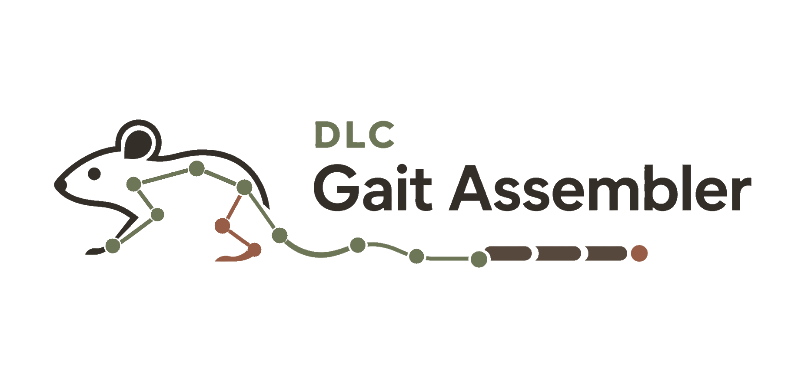

# DLC Gait Assembler

<p align="center">
  <picture>
    <source media="(prefers-color-scheme: dark)" srcset="src/dlc_gait_assembly/resources/branding/DLC-Gait-Assembler-logo-dark-original-clean.png">
    
  </picture>
</p>

A desktop application for preparing videos, processing DeepLabCut coordinates, and producing Runway and Ladder gait measurements.

## Install and launch

Use the main application environment for the interface and scientific analysis. DeepLabCut runs in its own environment.

```bash
conda env create -f src/dlc_gait_assembly/resources/environments/GAIT_ASSEMBLER.yaml
conda activate gait-assembler
python -m pip install -e .
dlc-gait-assembler
```

The existing `python gait_assembler.py` and `python -m dlc_gait_assembly` launchers remain available. Run `python -m pip install -e .` after updating an existing checkout so the installed launch command points to the current application. FFmpeg and FFprobe must be on PATH; the Conda recipe includes them. DeepLabCut's screen provides environment check, install/update, launch, and terminal actions using the packaged `DEEPLABCUT.yaml` recipe.

Installed wheels contain their fonts, icons, branding, scientific defaults, environment recipes, and preview examples. Neither the working directory nor a root `assets/` or upstream checkout is required. Scientific analysis uses the application environment by default. `DLC_GAIT_ALMA_PYTHON` optionally selects an external scientific interpreter; that environment must contain the same installed application version and scientific dependencies.

## Choose a workflow

**Runway → Manual** presents these stages in application order:

| Stage | Inputs and responsibility | Main handoff |
| --- | --- | --- |
| Calibration | Measure reference sticks on images/video frames; assess spatial scale by location, axis, and camera. | Conversion-map JSON and assessment report. |
| Video Processing | Select crop and inversion rectangles, per-video flips, trim ranges, enhancements, quality, and encoding preset. | Processed videos grouped by region, plus reusable settings and session manifests. |
| DeepLabCut | Use the separately installed pose-estimation environment and inspect project/model availability. | Paired CSV/H5 coordinates and labeled review videos in separate folders. |
| Knee Correction | Pair coordinate datasets, choose markers, segment lengths, direction, likelihood, and calibration. Review original and reconstructed knees. | Paired corrected CSV/H5 coordinates and correction reports. |
| Gait Analysis | Pair cameras, map body parts, configure calibration/timing/detection/filtering, review the full-recording preview, then analyze. | Per-recording stride/general tables, supported figures, stickplots, and run reports. |
| PCA / Random Forest | Combine recording summaries, audit eligible features, and run cohort analyses. | PCA, animal-grouped classification, repeated-measures models, tables, and figures. |

For gait analysis, choose **ALMA + post-ALMA features** or **RustLab1 standalone (three-view)**. ALMA supports single-side or matched left/right/bottom input. Standalone RustLab1 requires all three views, its own bottom reference paw, and its own stride-QC settings. It runs independently of ALMA and custom/synchronized post-ALMA calculations.

**Runway → Automatic** has three responsibilities: profiles store configuration and owned assets; runs execute the six stages; review approves the produced videos and stickplots or links to the manual stage for corrections. Create a profile from typed manual-settings snapshots or imported manifests, assign a DeepLabCut model to each processing region, add videos, and start the run. Review gates follow processed videos, labeled videos, and stickplots. Cancellation also releases a waiting review. Automatic stages call the same manual business operations.

**Ladder** is an independent workflow: select single/dual coordinate inputs and matching videos, configure paw markers/confidence/detection thresholds, detect events, review or reclassify them, and export the reviewed collection.

## Repository map and dependency rules

```text
src/dlc_gait_assembly/
  app/                       Application shell, routing, preferences, and dependency assembly
  runway/
    client/                  Runway entry menu
    manual/
      client/                Ordered manual-stage directory
      business/              Manual-stage identities and labels
      calibration/
      video_processing/
      deeplabcut/
      knee_correction/
      gait_analysis/
      pca_random_forest/
    automatic/
      client/                Assembly of profiles, runs, and review surfaces
      business/              Stage identities and shared execution/review contracts
      profiles/              Saved configuration, readiness, and owned assets
      runs/                  Run planning, stage handoffs, progress, and cancellation
      review/                Artifact inspection and explicit review decisions
  ladder/                    Independent Ladder analysis and event review
  shared/                    Cross-feature contracts, Qt controls, media, codecs, and process access
  resources/                 Installed assets, defaults, environment recipes, and license notices
  maintenance/               Explicit, journaled workspace migration and rollback

tests/                       Mirrors workflows/features/layers; fixtures stay under tests/fixtures
.vscode/                     Editor configuration
pyproject.toml               Packaging, launch commands, dependencies, and verification settings
MANIFEST.in                  Source archive inputs, test fixtures, and local-file exclusions
README.md                    Sole versioned Markdown document
workspace/                   Ignored saved sessions and application data
references/                  Ignored preserved source, imports, retired UI, SOP, and original guides
```

Each feature separates these layers:

| Layer | Owns | Depends on |
| --- | --- | --- |
| `client/` | Widgets, interaction, screen state, formatting, and Qt worker adapters. | Business operations and injected preview/I/O interfaces. |
| `business/` | Typed settings, validation, scientific calculations, decisions, contracts, and use cases. | Other business contracts/calculations; no Qt, filesystem access, subprocesses, or concrete adapters. |
| `infrastructure/` | Media access, codecs, persistence, external commands, report/figure rendering. | Business contracts; no widgets or navigation. |

`*_contracts.py` owns request/result types, `*_ports.py` describes required I/O, and `*_use_cases.py` coordinates operations. Calculation modules retain their named scientific responsibility. Figure modules consume prepared measurements and display data. Preview validity is a business decision. Feature clients do not import sibling feature clients; automatic workspace assembly composes its child surfaces. Shared code never imports a workflow. Concrete feature adapters and widget factories are connected in `app/app_bootstrap.py`. Controllers receive their view/dependencies explicitly; there are no shared-state mixins or permanent old-package facades.

See the complete [module ownership inventory](#module-ownership-inventory) below for filenames and their specific responsibilities.

## Saved data and migration

`DLC_GAIT_WORKSPACE` sets the data root. Otherwise a source checkout uses its `workspace/`; an installed distribution uses `~/DLC-Gait-Assembler/workspace`. User-selected external output folders remain supported.

```text
workspace/
  runway/
    manual/
      calibration/
      video_processing/
      deeplabcut/{analyzed_videos,labeled_videos}/
      knee_correction/
      gait_analysis/
      pca_random_forest/
    automatic/{profiles,runs}/
  ladder/analyses/
  development/ui_reviews/
  migrations/                Plans, journals, original metadata backups, and preserved output context
```

Recording names and paired coordinate filenames remain intact. Processing sessions allocate unique directories; automatic runs keep numbered stage directories and a final run manifest. Existing profile formats 1–5 retain their meaning and IDs unless divergent saved profiles collide. Generated Markdown reports are supported within ignored session data.

Migration is an explicit maintenance operation; application startup never relocates data. First create and inspect a dry-run plan, then apply it with a new journal:

```bash
dlc-gait-migrate dry-run --source-root /path/to/checkout --workspace /path/to/workspace --plan /path/to/plan.json
dlc-gait-migrate apply --plan /path/to/plan.json --journal /path/to/workspace/migrations/move.json
dlc-gait-migrate resume --journal /path/to/workspace/migrations/move.json
dlc-gait-migrate rollback --journal /path/to/workspace/migrations/move.json
```

The default command is a dry run. Migration merges `legacy_migrated` into the owning stage, keeps colliding recording bundles in stable session subfolders, verifies hashes, backs up rewritten metadata, preserves external references and scientific CSV/H5 bytes, and removes only accounted-for empty containers. Rollback checks for subsequent changes before restoring originals. Migration plans and journals are local data, not package dependencies.

Local context is preserved under `references/DLC-Gait-Analysis-main/`, `references/imports/`, and `references/repository_context/`. The retired source/UI, original assets, original documentation, and SOP are retained there. No application or test imports them. Their original locations and all references/workspace content are ignored by Git.

## Scientific outputs and controls

Each recording retains independent `left_stride_parameters.csv`, `right_stride_parameters.csv`, and `general_parameters/general_parameters.csv` outputs (single-side inputs use `side_stride_parameters.csv`). The default Hindlimb side file contains 53 measurement columns; Hindlimb + Forelimb contains 75 per side. Unavailable measurements remain blank. ALMA's multi-stride variability over 5 or 10 strides is excluded; within-cycle standard deviations remain available.

ALMA, RustLab1, and custom measurements share the configured confidence, interpolation, and Butterworth-filtering pass. Post-ALMA features retain the selected detector's exact canonical cycle boundaries. Each side keeps all its own strides; camera data are aligned by timestamps, never by left/right row number. Bottom-view calculations use the four paw labels `lhpaw`, `rhpaw`, `lfpaw`, and `rfpaw`; tail-base and bottom-center markers are not required.

Choose **Output → Save results to**, review a current stickplot, and run analysis. The default export includes supported ALMA/RustLab1 figures, side stickplots, and a report explaining accepted strides and unavailable measurements. **Output → View all parameter figures…** displays every exported measurement and cycle. Changes to inputs or analysis settings invalidate the preview; stale worker results cannot re-enable analysis.

### Troubleshooting

- **Run Gait Analysis is disabled:** complete the inputs/output folder and generate a current preview.
- **No strides are found:** check marker mapping, walking direction, calibration, likelihood, frame rate, and stride filters.
- **Multi-view measurements are missing:** review camera pairing, timestamps, body-part mappings, and per-camera scale.
- **Standalone RustLab1 has fewer than two onsets:** review the bottom reference paw, confidence default (0.95), and stance-speed default (7 px/frame).
- **Cohort analysis cannot run:** check animal/group identifiers, baseline phases, eligible features, and the run log's data requirements.

Use **Review pairings…** (or double-click a recording) for missing/duplicate camera assignments. Matching recognizes camera names in files or sibling folders and ignores DeepLabCut scorer suffixes; ambiguous files stay unassigned. Auto-fill preserves explicit assignments and study metadata. Side-view `back_toe` maps to ALMA's `toe`.

## Development and verification

```bash
conda activate gait-assembler
python -m pip install -e ".[dev]"
QT_QPA_PLATFORM=offscreen MPLBACKEND=Agg pytest -q
ruff check src tests gait_assembler.py
python -m build --sdist --wheel --no-isolation
```

Tests cover calculations with in-memory inputs, injected adapters, temporary media/coordinate files, scientific schemas and canonical cycles, UI navigation/themes/cleanup, profiles and review/cancellation, and migration collisions/resume/rollback. Scientific reference fixtures remain unchanged. Structural and NaN-mask assertions remain exact; the recorded cross-runtime ALMA numerical comparison uses `rtol=1e-8, atol=1e-8`.

Architecture tests enforce unique shipped module names and ownership docstrings, business/client/infrastructure dependency direction, injected feature I/O, absence of reference loaders and obsolete packages, and README-only versioned Markdown. Build/install verification should import and launch the wheel from an unrelated directory without repository assets or reference checkouts.

## Provenance and licenses

ALMA is the Automated Limb Motion Analysis toolbox by Aljovic, Zhao et al. ([Communications Biology, 2022](https://doi.org/10.1038/s42003-022-03077-6); [upstream source](https://github.com/sollan/alma)). The maintained ALMA calculations derive from the preserved ALMA implementation; their GPL-3.0 license text ships in `resources/licenses/ALMA-LICENSE`. Attribution and original context remain locally under ignored references. RustLab1 and custom SOP implementations, parameter metadata, and example-preview provenance remain identifiable by their named modules and in-app documentation. Noto Sans, Geist, and Tabler notices are packaged under `resources/licenses/`. These resources are included in both source installations and wheels.

<details>
<summary>Bottom-view inputs and supported parameters</summary>
<a id="bottom-paw-details"></a>

The current application uses the four paw markers below. Older center-based
definitions remain in the preserved research SOP for context.

The bottom view has exactly four mapping fields. CSV column order does not matter:

| CSV label | Anatomical marker | Mapping field |
| --- | --- | --- |
| `lhpaw` | Left hind paw | back left |
| `rhpaw` | Right hind paw | back right |
| `lfpaw` | Left fore paw | front left |
| `rfpaw` | Right fore paw | front right |

These labels are detected automatically. Existing `back-left`, `back-right`,
`front-left`, `front-right` and `d-`-prefixed labels also work. Manual mapping can
associate other CSV labels with these same four anatomical markers. No tail-base,
body-reference, rear-center, or front-center label is required.

## Parameters available with these bottom markers

| Exported parameter | Required bottom markers | Meaning | Scope |
| --- | --- | --- | --- |
| `mean_hindlimb_base_support` | `lhpaw`, `rhpaw` | Mean Euclidean hindpaw separation during bilateral stance, cm | Hindlimb |
| `variance_hindlimb_base_support` | `lhpaw`, `rhpaw` | Sample variance of that separation, cm² | Hindlimb |
| `opposite_hindlimb_phase_offset (%)` | `lhpaw`, `rhpaw` | Actual opposite-paw stance onset as a percentage of this side’s gait cycle | Hindlimb |
| `hindlimb_stance_overlap_fraction` | `lhpaw`, `rhpaw` | Percentage of the cycle with both hindpaws in stance | Hindlimb |
| `hindlimb_swing_overlap_fraction` | `lhpaw`, `rhpaw` | Percentage of the cycle with both hindpaws in swing | Hindlimb |
| `left__front__seconds` | `lfpaw` | Median interval between left forepaw stance onsets, seconds | Hindlimb + Forelimb |
| `right__front__seconds` | `rfpaw` | Median interval between right forepaw stance onsets, seconds | Hindlimb + Forelimb |
| `FLBR_RATIO` | All four paws | Fraction of non-all-stance frames with left forepaw and right hindpaw in different phases | Hindlimb + Forelimb |
| `FRBL_RATIO` | All four paws | Fraction of non-all-stance frames with right forepaw and left hindpaw in different phases | Hindlimb + Forelimb |

“Scope” refers to the app's limb-scope setting. All four bottom mapping fields are
shown in either scope. The default Hindlimb side export contains the first five
measurements; the combined scope adds the last four along with supported side-view
forelimb features. The original ALMA stride boundaries, frame rate, confidence
filtering, and spatial calibration still apply. These are bottom-marker
requirements, not a claim that the complete ALMA pipeline runs without side views.

## Removed parameters

Removing center-dependent measurements reduced the default catalog from 132 to
124 parameters. These eight entries were removed from selection, generated
parameter tables, and parameter documentation:

| Removed export names | Reason |
| --- | --- |
| `LB__avg_Angle`, `LB__max_Angle`, `LB__min_Angle` | Left hindpaw angle requires the rear bottom-center marker |
| `RB__avg_Angle`, `RB__max_Angle`, `RB__min_Angle` | Right hindpaw angle requires the rear bottom-center marker |
| `left_hindpaw_midline_distance` | Requires the rear bottom-center marker |
| `right_hindpaw_midline_distance` | Requires the rear bottom-center marker |

The optional combined catalog decreased from 178 to 164. It additionally
removes `LF__avg_Angle`, `LF__max_Angle`, `LF__min_Angle`, `RF__avg_Angle`,
`RF__max_Angle`, and `RF__min_Angle`, which require the front bottom-center marker.
Side-view elbow and wrist angles remain supported.

The old tail-base/body-reference mapping field was unused by the 132-feature
catalog and is removed. None of the retained features requires it.

## Three parameter files per recording

Each recording has **left_stride_parameters.csv**, **right_stride_parameters.csv**
and **general_parameters/general_parameters.csv** in its own folder. Videos are
never pooled. Left and right files each contain that side's own complete strides;
there is no opposite-side row pairing. Bottom features are recomputed for each
side's actual video-time interval and included in both side files.

Hindlimb side files have 53 measurement columns each: 32 ALMA, 12 RustLab1, four
custom side measurements and five shared bottom measurements. Forelimb scope
adds 18 own-side and four bottom measurements, for 75 per side. Identifiers,
source/video frame bounds and quality fields are additional. Missing measurements
remain blank and all headers remain present even when no complete strides exist.
The new opposite-paw phase offset replaces the old fixed-right-paw offset name;
bottom swing overlap is now also explicit. Whole-recording synchronization is
saved only as a recording-level summary, not repeated as a per-stride value.

See [export layout and timestamp rules](#per-recording-export-details) for
the three files, per-camera timing controls, coverage and measurement definitions.
The earlier 100/140 catalogs counted distinct side-specific measurements in one
wide table; their supported measurements are retained across the new side files.

Only ALMA's **between-stride variability** measures are removed: all
`Variability {x|y|xy} plane {5|10} strides {mean|SD}` columns. These are dynamic
time-warping comparisons across five or ten strides: 12 per side, 24 total.
This reduces the four-paw catalogs from 124 to 100 and from 164 to 140.

Within-cycle standard deviations remain: `toe-to-crest distance SD (cm)` and
`mtp joint SD (deg)`, `ankle joint SD (deg)`, `knee joint SD (deg)`, and
`hip joint SD (deg)`, on each side. The custom
`variance_hindlimb_base_support` also remains.

Parameter families share these side/general tables; there are no extra ALMA
tidy/summary CSVs. Figure options control SVG generation without suppressing
parameter columns. The separate RustLab1 standalone workflow retains its own
output settings.

## Quality control and compatibility

Center-marker trajectory coverage no longer affects cycle validity. Center-based
`body_speed_cm_s`, `mean_speed_cm_s`, `speed_cv`, `session_speed_cm_s`, and
`session_speed_cv` are removed from synchronized outputs. The body-speed variation
rejection rule is removed because these four paws do not measure body translation.
Tracking coverage and matched stance-onset checks remain. No synthetic body center
or substitute speed measurement is introduced.

Retired selections saved in older profiles are ignored. Existing exports are not
rewritten; rerun analysis to obtain the separate per-recording files. Preview figures label retired
bottom-angle panels and use the left hindpaw as the bottom trajectory reference.

See [stride comparison and calibration](#stride-detection-details) for
selectable detection methods, per-camera maps, and complete in-app parameter figures.

## Figure exports

The ALMA + post-ALMA workflow also saves separate left/right stick plots, seven
ALMA figures per side, and sixteen RustLab1 figures per reference side (18 with
forelimb scope). The RustLab1 folders identify whether left or right stride
windows were used. Bottom-center/tail-base angle plots and ALMA multi-stride
variability plots remain excluded. Choose the destination folder in Output.

</details>

<details>
<summary>Parameter exports by recording and side</summary>
<a id="per-recording-export-details"></a>

Choose **ALMA + post-ALMA features**, then choose **Output → Save results to**.
Use **Import analysis manifest** beside **Export analysis manifest** at the bottom
of the settings sidebar to restore a saved analysis JSON. It restores detection,
filters, timing, calibration values, label mappings and figure options while keeping
the selected CSVs and destination folder. Generate a new stick-plot preview after
importing. Invalid manifests are rejected before settings are applied.

Each paired recording has its own folder. Videos are never pooled into a parameter
CSV, and left/right strides are not paired into wide rows.

```text
chosen folder/
  export_report.txt
  001_recording_name/
    left_stride_parameters.csv
    right_stride_parameters.csv
    general_parameters/
      general_parameters.csv
    left_stickplot.svg
    right_stickplot.svg
    left_alma_figures/
    right_alma_figures/
    rustlab1_figures/
      left_strides/
      right_strides/
  002_next_recording/
    ...
```

## Which measurements go where

Each side file contains exactly one row per detected complete stride of that side.
Different row counts between sides are expected. A left stride is never dropped
because it has no matching right stride. `passed_stride_filters` indicates whether
ALMA accepted the stride's spatial measurements; rejected measurements stay blank
while the stride's bounds and quality fields remain available.

Each hindlimb side table contains 53 measurement columns: 32 ALMA measurements,
12 RustLab1 measurements from that side, four custom side measurements, and five
bottom-paw measurements. Identifiers, times, frame bounds and coverage columns
are additional. Forelimb scope has 75 measurement columns per side: 18 more
side measurements and four more bottom measurements. Within-stride standard
deviations remain; ALMA variability across groups of 5 or 10 strides is excluded.

The bottom measurements are recalculated for **each individual side stride's
time interval** and appear in both files:

| Measurement | Meaning within the side stride |
| --- | --- |
| `mean_hindlimb_base_support` | Mean hind-paw separation during bilateral stance, in cm |
| `variance_hindlimb_base_support` | Sample variance of that separation, in cm²; this is within-stride variation, not ALMA variability across strides |
| `opposite_hindlimb_phase_offset (%)` | First actual opposite hind-paw touchdown relative to this side's stride start; blank if no observed onset occurs |
| `hindlimb_stance_overlap_fraction` | Percentage of this stride with both hind paws in stance (legacy column name; values are 0–100) |
| `hindlimb_swing_overlap_fraction` | Percentage of this stride with both hind paws in swing (0–100) |
| `left__front__seconds`, `right__front__seconds` | With forelimb scope: median duration of fully tracked forepaw cycles intersecting this stride |
| `FLBR_RATIO`, `FRBL_RATIO` | With forelimb scope: diagonal-paw phase disagreement within this stride, as a 0–1 ratio |

The opposite paw is the right hind paw in the left table and the left hind paw in
the right table. A window starting during stance does not invent a touchdown at
its first frame. Only `lhpaw`, `rhpaw`, `lfpaw`, and `rfpaw` are used for bottom
measurements. Tail base and bottom center remain excluded; see
[the marker and removal list](#bottom-paw-details).

`general_parameters/general_parameters.csv` has one row for that recording. It
contains whole-recording hindlimb stance overlap, swing overlap, same/opposite
phase percentages, and diagonal phase ratios, plus source files, camera frame
rates, timing sources, side stride counts, bottom scales and synchronization
coverage. These statistics use the common recording time interval, including
usable time outside detected strides. They are not averages of stride rows and
are not copied into either side table as if they were per-stride observations.

Bottom phase measurements retain their documented speed-threshold definitions:
calibrated 2D speed for hind-paw custom features and RustLab1 horizontal paw speed
for forepaw/diagonal features. Selecting a side stride detector changes the side
windows; it does not redefine these bottom feature formulas.

## Matching video timestamps

**Setup → View timing** provides FPS and a time offset for left, right and bottom.
Zero FPS means infer FPS from explicit CSV timestamps when present, otherwise
use the shared frame rate. An offset is added to that camera's timestamps;
positive offsets move the camera later. Defaults assume synchronized crops.

The time source is, in order:

1. An explicit numeric video-time column (`timestamp`, `time_s`, `timestamp_s`,
   `time_(s)`, `timestamp_(s)`, `timestamp_ms`, or `time_ms`). These are timestamps
   on the shared video timeline, not times relative to a crop's filename.
2. Clip start parsed from `HH.MM.SS.mmm-HH.MM.SS.mmm` in the filename, plus source
   frame number divided by that view's FPS. The frame numbers must be relative
   to that clip origin. Without a clip timestamp, origin zero is used.

The configured FPS must describe the coordinate video. Filename end times do
not override it. CSV timestamps must follow a constant-rate video frame grid;
inconsistent timestamps produce an explanatory error. Camera clock drift is
not estimated automatically.

Missing CSV frame numbers retain their position on the timeline; later rows
are never shifted earlier to close a gap. Each camera is filtered at its own
native FPS. Other-view coordinates used in side figures are sampled at the side
timestamps without extrapolation. Bottom measurements use native bottom frames
and their temporal overlap with the side's stride interval, including partial
frame weights at interval boundaries.

`stride_start (s)` is inclusive and `stride_stop (s)` is exclusive. Local
`stride_start (frame)` / `stride_end (frame)` and original
`source_start_frame` / `source_end_frame` are inclusive. `bottom_start_frame`
and `bottom_end_frame` identify overlapping original bottom frames. Alignment
coverage describes available source time; tracking coverage additionally uses
the confidence cutoff and configured bounded gap allowance. Incomplete bottom
windows leave dependent measurements blank. No shared time across all three
views stops the export with a timing/pairing error.

## Figures and validation

Both stick plots use the exact detector, side coordinates and stride boundaries
used for the corresponding side table. ALMA figures use that side's measurements.
RustLab1 figures are separated by reference side; each folder uses that side's
stride windows. Parameter-preview pages retain the recording and side in their
titles and never pool videos.

Default hindlimb export produces 51 files per recording (three CSVs and 48 SVGs),
plus one export report shared by the run. Forelimb scope adds four SVGs per
recording. Completion requires readable CSVs with the expected row counts and
nonempty, parseable figures. Unavailable measurements remain blank.

Single-side input produces a side-stride CSV and a general metadata CSV; it
cannot create measurements for an absent camera. The separately selected
RustLab1 standalone workflow retains its own output format.

</details>

<details>
<summary>Full-recording stick plots, stride detection and calibration</summary>
<a id="stride-detection-details"></a>

## Finding the controls

Use the installation commands above after updating the checkout, then restart the application.

In **Manual → Gait analysis**, select **Spontaneous walking** in **Setup**.
The dedicated **Stride detection** tab is now in the first navigation row, next to
**Calibration**. It contains the method selector and **Compare all 13 stick plots…**.
Camera maps and independent left, right and bottom scales are in **Calibration**.
Treadmill mode keeps its existing detector; the thirteen-method comparison is for
spontaneous/overground recordings. RustLab1 standalone retains its own Stride QC settings.

## Reading the stick plots

Every preview now covers **frame 0 through the last source frame**, including pauses,
partial cycles and cycles rejected by measurement filters. There is no displayed-stride
count setting. Old manifest `n_continuous_strides` values remain readable but do not
limit previews or CSV output.

Previously, each method selected its own small stride window. The renderer also added
frames at that method's phase changes. Thus changing the detector changed the actual
skeleton drawing. Both behaviours have been removed.

For each side, all methods now use the same filtered marker geometry, confidence mask,
every source frame, fixed figure layout and identical spatial/time axes. Only phase
colours, stride markers and explanatory text vary. The comparison checks spatial bounds;
regression tests compare every actual SVG skeleton path across all thirteen methods and
against the individual preview. Changing methods preserves the selected Left/Right tab.

Grey means inferred stance, orange swing and pale uncertain phase. Stick plots use thin lines, no point markers, a single phase strip and a compact legend. Missing
joints are omitted consistently across methods; confidence gaps never become invented
limb coordinates. The compact strip below the skeleton labels the same source frames.
Stride counts are allowed to differ: enforcing equal counts would alter the detections.
A method with no complete strides still draws the full recording with a zero-count label.
Bottom-based methods require a synchronized bottom CSV; no side-based method is silently
substituted when it is missing.

Cycles that fail spatial measurement filters remain visible; the accepted count is shown at the top. White lines in the phase strip mark stride starts. Their rejected measurements remain blank in the CSV. Detection is no longer
bypassed by the legacy whole-recording dragging shortcut. Preview and export call the
same selected detector. The standalone RustLab1 preview also uses full side-view skeletons.

## The thirteen methods

| Method | Phase / boundary rule | Main limitation |
| --- | --- | --- |
| ALMA (legacy) | The app's modified ALMA: side toe height plus global speed hysteresis. | Global thresholds can struggle with speed/floor changes. This is distinct from the historical original below. |
| Adaptive paw speed | Locally slow 2D toe movement enters stance; fast movement enters swing, using half-second rolling quantiles. | Jitter and pauses affect local thresholds. |
| Paw excursion peaks | Forward extrema of toe X relative to hip X delimit cycles; maximum retraction ends stance. Partial edge phases use relative velocity. | Needs reliable toe and hip; extrema estimate contact indirectly. |
| Bottom paw speed | Adaptive 2D speed on each bottom hind paw sets its side's timing. | Needs synchronized bottom tracking. |
| RustLab1 (bottom paw) | Absolute bottom-paw horizontal displacement at/below a fixed threshold is stance. | Pixel/frame threshold depends on scale and frame rate. |
| ALMA (original 2021) | Historical spontaneous rule: absolute raw toe displacement ≤0.001 px/frame, onset confidence >0.6, and >20 px between admitted contacts. | Extremely strict for noisy overground tracks; may return zero strides. |
| Speed histogram (Otsu) | Split log toe speed at maximum between-class histogram separation; slow group is stance. | One global threshold, experimental. |
| Speed mixture (GMM) | Fit two Gaussian components to log toe speed; slower component is stance. | Assumes two speed populations, experimental. |
| Speed Mixture + Nearby Confidence | Starts from Speed mixture probabilities and uses evidence before and after each frame to refine stance/swing support. | Model support is not measured contact accuracy; strong smoothing can suppress genuine short phases. |
| Paw height mixture (GMM) | Fit two height populations; the spatially lower component is stance. | Needs a stable floor and visible paw lift, experimental. |
| Hip-relative velocity | Backward toe movement relative to the hip is stance; forward movement is swing. | Hip errors and body movement can obscure contact, experimental. |
| Height + speed contact | Combine locally low speed with proximity to the locally estimated floor. | May miss dragging/shuffling contact, experimental. |
| Temporal speed + height | Two-state dynamic programming with 60% local speed and 40% local height evidence and a 2.5 log-cost switching penalty. | Hand-designed motion model, not a trained contact classifier; experimental. |

The historical rule is ported from the pre-publication
[ALMA source at commit 89f7be7](https://github.com/sollan/alma/blob/89f7be705a730fc0c0acf90817357b6449535df0/Functions/KinematicsFunctions.py#L1084).
Its license is packaged in `resources/licenses/ALMA-LICENSE`. Wrapper changes align displacement to
the destination source frame, omit the unfinished final cycle, exclude long confidence
gaps, and suppress recordings whose trusted X/Y range is below 0.5 pixels. This is the
original **spontaneous contact rule**, not a claim to reproduce every original ALMA
preprocessing step, treadmill rule or parameter formula.

RustLab1 calls the same `detect_rustlab1_strides` and `rustlab1_stance_mask` functions as
standalone mode. Its default stance limit is 7 px/frame; tracking-jump limit is 100
px/frame. Speed and minimum phase lengths are editable in **Stride detection** when
selected and persist in manifests. `lhpaw` sets left timing and `rhpaw` right timing.
Standalone RustLab1 instead uses its selected single reference paw for both views,
matching that workflow's exported measurements.

Side and bottom signals use the configured low-pass filter; original ALMA's strict
contact rule intentionally examines raw toe X. This distinction affects phase labels,
not drawing geometry. Hip-based methods infer automatic travel direction from hip
motion and behave consistently with mirrored cameras. Most adapted detectors require
80 ms between contacts and clean short phase runs; RustLab1 uses its own configurable
minimum phase lengths and historical rule. These constraints never crop the drawing.

Confidence handling is in **Stride detection → Bridge tracking gaps (frames)**.
The default **Auto (up to 50 ms)** converts this duration to a whole-frame limit using
the selected frame rate (6 frames at 120 fps; 11 at 239.8 fps). Only internal gaps
bounded by usable observations are bridged. **0** explicitly requests strict detection:
even a single missing timing frame excludes its whole cycle. Positive values set an
exact frame limit. Existing manifests with an explicit 0 retain that strict choice.
Complete cycles crossing longer gaps are excluded, and tracking resuming mid-stance
is no longer mistaken for a touchdown. The added temporal
model restarts after such a gap. A common subpixel stationary-recording guard prevents
floating-point filter ripples from creating strides. The guard was added after tests
reproduced false cycles in the legacy, histogram and relative-velocity detectors.

## Independent spatial scales

In **Calibration → Calibration by view**, enter left/right pixels per cm
or import a separate map for each camera. For a map containing multiple views,
choose the camera entry explicitly. Bottom X and Y remain independently editable.
Importing one camera's map does not change the others. Zero side values use the
shared setting for compatibility with existing profiles.

Each side's scale applies to its ALMA spatial parameters, RustLab1 side-view
features, and custom side-view measurements. A manual side scale also overrides
the treadmill-derived spatial scale. Isotropic scale changes do not change joint
angles. The selected numeric scales, map provenance, method, and gap setting are
saved in exported analysis-settings manifests.

File-only camera calibrations are resolved before both preview and export. A
separate map with multiple camera entries requires a selected view index; it does
not silently use the first camera. Bottom map imports preserve separate X and Y
scales. Importing a shared map leaves already configured bottom values alone.
Saved numeric values are calibration snapshots and remain usable if their original
map is moved. When an automatic profile explicitly selects a new shared map, that
map replaces the shared snapshot while preserving independent camera overrides.

For spontaneous walking with anatomical-reference calibration, the selected
segment length is now estimated in each side camera independently. That exact
scale is also used by the post-ALMA measures. Unusable reference markers produce
an actionable calibration message instead of silently assuming 49.143 px/cm.
The legacy treadmill scale calculation remains available when no manual camera
override is selected.

## Speed Mixture + Nearby Confidence

Select **Stride detection → Speed Mixture + Nearby Confidence**. The same two-component
log-speed mixture is fitted as in Speed mixture (GMM). A symmetric two-state temporal
model then combines each frame's probability with surrounding evidence, using normalized
forward/backward inference. Agreement strengthens phase support; conflicting neighbours
leave a transition uncertain. It never forces every frame to become more confident.

**Neighbour context** defaults to 60 ms and controls a persistence timescale, not a fixed
window radius. Zero disables temporal context and returns the raw GMM probabilities.
Unlike plain GMM, this model does not apply a later Boolean run cleanup that would
contradict its posterior. Short confidence gaps follow the configured interpolation
policy; untrusted/long gaps stop context propagation. Entirely ambiguous or stationary
traces retain 50% support. Frames below 70% support appear pale; this display threshold
is separate from DLC likelihood and does not discard calculated measurements.

The model neither changes marker coordinates nor increases DLC tracking likelihood.
Its uncertainty is **model support**, not empirically calibrated contact accuracy.

## Complete outputs and figures

In **Output → Save results to → Choose folder…**, choose the destination, then select
**Analyze and save outputs** after reviewing the stick plots. All three figure options
are enabled by default and visible. The Inputs page's destination field and this picker
stay synchronized. **Open saved results folder** opens the actual completed destination.

A paired hindlimb recording exports three CSVs and 48 SVG figures, plus the run's
shared `export_report.txt`. Every recording has a separate folder containing
`left_stride_parameters.csv`, `right_stride_parameters.csv`, and
`general_parameters/general_parameters.csv`. Each side uses its own strides;
bottom features are recomputed for each side's video-time windows. Whole-recording
synchronization belongs in the general file. Hindlimb tables contain 53 measurement
columns per side, or 75 with forelimbs, plus identifiers and quality fields.

There are two full-recording stick plots, seven ALMA figures per side, and 16
RustLab1 figures per reference side (18 with forelimbs) in
`rustlab1_figures/left_strides/` and `rustlab1_figures/right_strides/`.
Bottom-center/tail-base angles and ALMA multi-stride variability remain excluded.
Figures reuse the CSV calculations. Unavailable measurements remain blank.

**Setup → View timing** sets per-camera FPS and timestamp offsets. See
[per-recording exports](#per-recording-export-details) for the full layout,
measurement classification, frame bounds, coverage and timestamp rules.

### Per-stride export and brief tracking gaps

Short confidence dips can reject complete strides when the allowed tracking gap is
zero. The default Auto allowance is bounded and frame-rate-aware; it preserves the
confidence cutoff and spatial filters. Previews and exports apply the same gap
rules, so CSV frame bounds and white stride markers agree.

Each side file includes `stride_number`, `passed_stride_filters`, `timing_observed (%)` and
`timing_gap_frames`. The last two describe the marker(s) used for timing, before short
gaps are bridged; they are not joint-tracking accuracy scores. Rejected spatial
measurements remain blank with a false filter flag, retaining the stride's identity
and bounds. Every detected stride occurs exactly once in its own side file,
checked before writing; left and right row counts can differ.

Long dropouts remain excluded. The report and general file record timing sources,
frame rates, calibrations, likelihood cutoffs, and stride counts.
The heatmap includes all available ALMA parameters instead of selecting the highest 24.
Columns labelled `(%)` now export 0–100 values; legacy ALMA fractions are converted at
the reporting boundary to match the documented units. Raw legacy extraction is unchanged.

The selected destination is checked for write access before calculation. Completion is
reported only after checking all expected files are nonempty, SVGs parse, and the saved
CSV row count matches the calculation. The results browser lists every generated figure
and the CSVs. Existing unrelated files in the destination are not removed.

**Output → View all parameter figures…** additionally displays all exported parameters
in pages of 12 plots per recording and side, including missing-value counts. Figure documentation examples are
historical reference illustrations, not outputs from the current recording.

Standalone RustLab1 remains a separate workflow: it exports its own tables and supported
figures plus two full-recording side stick plots (replacing its old speed-chart preview).
Use **ALMA + post-ALMA features** for the per-recording bundle described above.

## Reproducing the verification

Synthetic stride-detector checks live in
[the detector tests](tests/runway/manual/gait_analysis/business/alma/test_stride_candidates.py).
Full-recording geometry and export checks live in
[the stickplot comparison tests](tests/runway/manual/gait_analysis/integration/test_stickplot_comparison.py).
Use the development commands above with the application's scientific environment.
Original benchmark notes remain locally under ignored references.

</details>

## Module ownership inventory

Paths below are relative to `src/dlc_gait_assembly/`. Package marker files (`__init__.py`) are omitted. Each module has one named responsibility; additional scientific modules keep the newer detector and timestamp behavior explicit.

<details>
<summary>app — 12 modules</summary>

| Module | Responsibility |
| --- | --- |
| `app_bootstrap.py` | Create the Qt application and inject concrete adapters, use cases, page factories, and typed snapshot providers. |
| `business/app_navigation_routes.py` | Application route identities and selected navigation state without widget factories. |
| `client/app_branding_widgets.py` | Render application and partner logos, credits buttons, and menu illustrations. |
| `client/app_credits_menu.py` | Build attribution actions and open the associated project and partner links. |
| `client/app_header_navigation.py` | Assemble primary and workflow navigation, branding, and theme controls. |
| `client/app_home_view.py` | Present the Ladder and Runway entry choices and animate the existing menu artwork. |
| `client/app_navigation_animations.py` | Animate workflow expansion, navigation highlights, and page transitions. |
| `client/app_page_contracts.py` | Define page factories, typed manual snapshots, and public page lifecycle contracts. |
| `client/app_route_controller.py` | Select application pages and enforce their public leave and resource-release contracts. |
| `client/app_shell_styles.py` | Style the application shell, navigation, and active workspace surfaces. |
| `client/app_shell_window.py` | Own the main window, content host, theme propagation, and page cleanup. |
| `infrastructure/app_preferences_store.py` | Persist theme and serialized window geometry in the existing QSettings namespace. |

</details>

<details>
<summary>runway/client — 1 module</summary>

| Module | Responsibility |
| --- | --- |
| `runway_home_view.py` | Present Manual and Automatic choices within the Runway workflow. |

</details>

<details>
<summary>runway/manual/client — 1 module</summary>

| Module | Responsibility |
| --- | --- |
| `manual_stage_directory.py` | Present the six manual Runway stages in their declared application order. |

</details>

<details>
<summary>runway/manual/business — 1 module</summary>

| Module | Responsibility |
| --- | --- |
| `manual_stage_definitions.py` | Define manual stage identities, order, labels, descriptions, and presentation asset identifiers. |

</details>

<details>
<summary>runway/manual/calibration — 19 modules</summary>

| Module | Responsibility |
| --- | --- |
| `business/calibration_assessment_contracts.py` | Define spatial-scale assessment checks, pass/fail results, and recommendations. |
| `business/calibration_conversion_map.py` | Build the reusable spatial conversion map from the assessed stick measurements. |
| `business/calibration_geometry.py` | Calculate marker positions and axis-aligned or Euclidean stick-segment distances. |
| `business/calibration_measurements.py` | Define reference points, sticks, marker intervals, and measurement collections. |
| `business/calibration_ports.py` | Output contract for conversion maps and assessment reports. |
| `business/calibration_quality_checks.py` | Evaluate location, axis, and cross-view agreement against the configured tolerance. |
| `business/calibration_scale_estimation.py` | Aggregate pixels-per-unit measurements by location, axis, and view. |
| `business/calibration_use_cases.py` | Assess reference measurements and coordinate conversion-map and report exports through ports. |
| `client/calibration_canvas.py` | Manage calibration zoom, selection, reference-stick drawing, and editing interactions. |
| `client/calibration_controller.py` | Connect reference-media selection, measurement edits, assessments, and calibration exports. |
| `client/calibration_editor_state.py` | CalibrationEditorState owns selections, editable state, and preview validity for this workspace. |
| `client/calibration_media_panel.py` | Present selected images and videos with frame-seeking controls. |
| `client/calibration_results_panel.py` | Present location, axis, and view checks with their assessment recommendations. |
| `client/calibration_settings_panel.py` | Edit marker intervals, measurement units, tolerance, and distance method. |
| `client/calibration_stick_item.py` | Render editable stick endpoints, interior markers, and assessment failure highlights. |
| `client/calibration_styles.py` | Style calibration media, measurement settings, canvas, and assessment controls. |
| `client/calibration_view.py` | Assemble media, settings, drawing, results, and export controls for calibration. |
| `infrastructure/calibration_export_writer.py` | Save conversion-map JSON and the accompanying calibration report in a collision-safe session. |
| `infrastructure/calibration_report_formatter.py` | Format measured scale values, consistency checks, and assessment recommendations for reports. |

</details>

<details>
<summary>runway/manual/video_processing — 33 modules</summary>

| Module | Responsibility |
| --- | --- |
| `business/video_crop_geometry.py` | Calculate pixel crop bounds from normalized regions and source frame dimensions. |
| `business/video_enhancement_settings.py` | Define video enhancement values, defaults, clamping, and FFmpeg-independent validation. |
| `business/video_processing_contracts.py` | Define video regions, trims, enhancements, export options, processing jobs, and results. |
| `business/video_processing_plan.py` | Resolve each source video into separate crop, inversion, flip, trim, and enhancement jobs. |
| `business/video_processing_ports.py` | Required video exporter and manifest persistence capabilities. |
| `business/video_processing_use_cases.py` | Resolve processing jobs, execute them through the exporter, and preserve output order. |
| `business/video_region_geometry.py` | Define normalized and pixel crop rectangles and validate their bounds. |
| `business/video_region_operations.py` | Own region identities, crop names, inversion rectangles, and per-video flip assignments. |
| `business/video_trim_ranges.py` | Validate, order, merge, and select video trim intervals. |
| `client/video_crop_controls.py` | Build crop name, pixel-boundary, dimension, deletion, and flip-assignment controls. |
| `client/video_editor_controller.py` | Connect editor actions, settings manifests, and video-export requests. |
| `client/video_editor_state.py` | VideoEditorState owns selections, editable state, and preview validity for this workspace. |
| `client/video_enhancement_controls.py` | Build enhancement sliders, numeric controls, and reset actions for the selected operation. |
| `client/video_export_dialog.py` | Collect export location, quality, and encoding-preset choices. |
| `client/video_export_worker.py` | Bridge planned video export progress, cancellation, and results into Qt signals. |
| `client/video_flip_assignment.py` | Edit crop flip flags and their per-video horizontal/vertical assignments. |
| `client/video_inversion_controls.py` | Edit regional inversion rectangles through the video canvas coordinate interface. |
| `client/video_operation_settings_panel.py` | Compose crop, enhancement, flip, and trim panels for the selected video operation. |
| `client/video_playback_controller.py` | Coordinate video selection, frame seeking, debounced requests, and preview updates. |
| `client/video_preview_effects.py` | Apply display-only enhancement effects to already-decoded preview frames. |
| `client/video_processing_styles.py` | Style video sources, region operations, timeline, and export controls. |
| `client/video_processing_view.py` | Assemble source videos, the region canvas, operation controls, and export status. |
| `client/video_region_canvas.py` | Display decoded frames, crop shading, inversion overlays, and canvas coordinates. |
| `client/video_region_item.py` | Implement video-region handles, hit testing, dragging, resizing, and deletion. |
| `client/video_source_list.py` | Present source videos and their processing status. |
| `client/video_trim_controls.py` | Add, select, remove, and numerically edit trim ranges for each video. |
| `client/video_trim_timeline.py` | Display editable trim intervals on the video-seeking timeline. |
| `infrastructure/video_ffmpeg_command.py` | Assemble encoding, audio, and filter arguments for one FFmpeg export. |
| `infrastructure/video_ffmpeg_exporter.py` | Execute planned video jobs through the cancellable shared command adapter. |
| `infrastructure/video_ffmpeg_filters.py` | Translate processing settings into FFmpeg filter expressions without deciding which jobs to run. |
| `infrastructure/video_output_allocator.py` | Allocate collision-safe processed-video paths while preserving recording names. |
| `infrastructure/video_session_document_writer.py` | Persist processing-session manifests, generated summaries, and export artifact references. |
| `infrastructure/video_settings_manifest_store.py` | Read and write reusable crop, flip, trim, inversion, and enhancement manifests. |

</details>

<details>
<summary>runway/manual/deeplabcut — 20 modules</summary>

| Module | Responsibility |
| --- | --- |
| `business/deeplabcut_analysis_use_cases.py` | Coordinate validated pose-analysis and labeled-video jobs through project, bridge, and artifact ports. |
| `business/deeplabcut_artifact_rules.py` | Classify coordinate tables, labeled videos, and their owning region directories. |
| `business/deeplabcut_environment_use_cases.py` | Resolve supported environment actions and coordinate terminal sessions without Qt. |
| `business/deeplabcut_job_contracts.py` | Define DeepLabCut analysis/labeled-video jobs, model metadata, and produced artifacts. |
| `business/deeplabcut_ports.py` | Required project, command, environment, bridge, and artifact operations for DeepLabCut. |
| `business/deeplabcut_project_rules.py` | Validate already-inspected DeepLabCut project metadata and model completeness. |
| `client/deeplabcut_controller.py` | Connect DeepLabCut environment checks, installation, launch, and command-session actions. |
| `client/deeplabcut_environment_status.py` | Present DeepLabCut availability, running, and failure states and enabled actions. |
| `client/deeplabcut_job_worker.py` | Translate an injected command session's output and completion into Qt signals. |
| `client/deeplabcut_styles.py` | Style DeepLabCut environment actions, terminal controls, and status presentation. |
| `client/deeplabcut_terminal_controller.py` | Connect terminal commands and command-session events to DeepLabCut presentation state. |
| `client/deeplabcut_terminal_widget.py` | Present DeepLabCut terminal output and command entry with input history. |
| `client/deeplabcut_view.py` | Assemble environment actions, installation status, terminal, and output controls. |
| `infrastructure/deeplabcut_bridge_client.py` | Serialize jobs and read results from the separate DeepLabCut environment. |
| `infrastructure/deeplabcut_bridge_entry.py` | Execute pose analysis or labeled-video requests inside the separately installed DeepLabCut environment. |
| `infrastructure/deeplabcut_conda_commands.py` | Construct quoted platform-specific Conda environment and DeepLabCut launch commands. |
| `infrastructure/deeplabcut_environment_adapter.py` | Build platform commands, resolve terminal directories, and manage manual DLC artifacts. |
| `infrastructure/deeplabcut_output_organizer.py` | Collect and place DeepLabCut coordinate and labeled-video artifacts in their owning folders. |
| `infrastructure/deeplabcut_progress_parser.py` | Interpret DeepLabCut command output as analysis progress events. |
| `infrastructure/deeplabcut_project_reader.py` | Inspect project configuration, training metadata, and required model files. |

</details>

<details>
<summary>runway/manual/knee_correction — 21 modules</summary>

| Module | Responsibility |
| --- | --- |
| `business/knee_coordinate_correction.py` | Apply knee direction and confidence rules while preserving coordinate-table structure. |
| `business/knee_correction_contracts.py` | Define paired coordinate inputs, knee settings, reconstruction reports, and corrected results. |
| `business/knee_correction_ports.py` | Contracts for paired coordinates, settings persistence, and correction outputs. |
| `business/knee_correction_use_cases.py` | Load paired datasets, reconstruct knees, and persist paired corrected results. |
| `business/knee_dataset_pairing.py` | Match coordinate CSV/H5 pairs and optional source videos by recording identity. |
| `business/knee_marker_matching.py` | Resolve body-part aliases, limb sides, segment endpoints, and target knee markers. |
| `business/knee_preview_sampling.py` | Choose representative frames and prepare original and reconstructed joint coordinates. |
| `business/knee_triangulation.py` | Calculate candidate knee positions from the two segment lengths and endpoint geometry. |
| `client/knee_correction_controller.py` | Connect dataset pairing, knee settings, preview requests, and corrected-output execution. |
| `client/knee_correction_styles.py` | Style knee dataset selection, reconstruction settings, coordinate previews, and results. |
| `client/knee_correction_view.py` | Assemble paired inputs, knee settings, coordinate preview, and execution controls. |
| `client/knee_correction_worker.py` | Bridge paired knee reconstruction progress, reports, and completion into Qt signals. |
| `client/knee_editor_state.py` | KneeEditorState owns selections, editable state, and preview validity for this workspace. |
| `client/knee_input_panel.py` | Select and present matched CSV/H5 datasets and optional source videos. |
| `client/knee_preview_canvas.py` | Render original and reconstructed limb joints over an optional decoded video frame. |
| `client/knee_preview_controller.py` | Coordinate sampled knee previews, decoded media frames, caching, and invalidation. |
| `client/knee_result_panel.py` | Present corrected coordinate files and marker-level reconstruction reports. |
| `client/knee_settings_panel.py` | Edit knee markers, segment lengths, direction, confidence, and calibration settings. |
| `infrastructure/knee_coordinate_repository.py` | Read paired DeepLabCut coordinates using the shared CSV/H5 codecs. |
| `infrastructure/knee_result_document_writer.py` | Persist matching corrected CSV/H5 tables with recording and marker metadata. |
| `infrastructure/knee_settings_manifest_store.py` | Read and write reusable knee reconstruction settings manifests. |

</details>

<details>
<summary>runway/manual/gait_analysis — 117 modules</summary>

| Module | Responsibility |
| --- | --- |
| `business/alma/alma_analysis_engine.py` | Select treadmill or spontaneous ALMA calculations and assemble one recording result. |
| `business/alma/alma_analysis_settings.py` | Define ALMA analysis settings and translate already-loaded scientific defaults. |
| `business/alma/alma_bodypart_aliases.py` | Resolve ALMA body-part labels and preserve established anatomical aliases. |
| `business/alma/alma_continuous_sequences.py` | Select continuous accepted cycle sequences for scientific previews and summaries. |
| `business/alma/alma_cycle_quality.py` | Apply the established treadmill and spontaneous stride acceptance rules. |
| `business/alma/alma_drag_detection.py` | Detect dragging frames and calculate per-cycle drag durations. |
| `business/alma/alma_figure_data.py` | Prepare ALMA trajectory, timing, and cycle data for infrastructure figure rendering. |
| `business/alma/alma_joint_kinematics.py` | Calculate limb joint, elevation, and segment-length measurements. |
| `business/alma/alma_reference_calibration.py` | Estimate anatomical-reference scale and treadmill speed from tracked coordinates. |
| `business/alma/alma_signal_filter.py` | Apply the established ALMA marker interpolation and Butterworth-filtering calculations. |
| `business/alma/alma_spontaneous_cycles.py` | Detect spontaneous walking stance, swing, and dragging cycle boundaries. |
| `business/alma/alma_spontaneous_parameters.py` | Assemble spontaneous-walking cycle measurements without altering canonical cycle boundaries. |
| `business/alma/alma_stride_measurements.py` | Calculate stride length, stance/swing durations, speed, and established trajectory comparisons. |
| `business/alma/alma_treadmill_correction.py` | Correct marker trajectories for treadmill movement and walking direction. |
| `business/alma/alma_treadmill_cycles.py` | Detect treadmill stance intervals and canonical cycle boundaries. |
| `business/alma/alma_treadmill_parameters.py` | Assemble treadmill cycle measurements using the established ALMA formulas and acceptance rules. |
| `business/alma/gait_stride_detection.py` | Selectable, confidence-aware overground detectors, compared on source frames. |
| `business/alma/stride_candidates.py` | Experimental phase estimators. They label frames; none may transform plot geometry. |
| `business/alma/temporal_speed_mixture.py` | Neighbour-conditioned GMM probabilities without changing tracking coordinates. |
| `business/alma/tracking_gap_policy.py` | A frame-rate independent allowance for brief losses of the timing marker. |
| `business/custom_features/custom_sop_feature_calculations.py` | Calculate the maintained custom SOP measurements on authoritative ALMA cycles. |
| `business/custom_features/custom_sop_feature_definitions.py` | Define custom SOP parameter names, units, and marker requirements. |
| `business/gait_analysis_contracts.py` | Define gait-analysis results and returned recording artifacts. |
| `business/gait_analysis_ports.py` | Input tables, result storage, and rendering required by gait use cases. |
| `business/gait_analysis_use_cases.py` | Coordinate recording calculations, selected parameters, output tables, figures, and run reports through ports. |
| `business/gait_bottom_windows.py` | Bottom-paw measurements on actual video-time intervals, for either side. |
| `business/gait_coordinate_contracts.py` | Define matched camera inputs, study identifiers, and preprocessed coordinate snapshots. |
| `business/gait_input_pairing.py` | Infer recording groups and camera roles from filenames and sibling view folders without list-order pairing. |
| `business/gait_marker_requirements.py` | Resolve required markers and aliases for the selected method, camera views, and limb scope. |
| `business/gait_preview_use_cases.py` | Prepare full-recording scientific previews and detector comparisons without running the export pipeline. |
| `business/gait_preview_validity.py` | Track preview generations and reject results invalidated by input or settings changes. |
| `business/gait_recording_tables.py` | Independent left/right stride tables and one recording-level general table. |
| `business/gait_standalone_contracts.py` | Define standalone gait inputs, calibrated view data, and numerical result contracts. |
| `business/gait_stride_export.py` | Stride identity and quality fields, and checks against accidental row loss. |
| `business/parameters/alma_parameter_definitions.py` | Define ALMA measurement names, units, descriptions, and marker requirements. |
| `business/parameters/bottom_paw_parameter_contract.py` | Supported bottom-paw outputs and retired center-marker measurements. |
| `business/parameters/gait_parameter_contracts.py` | Define parameter metadata, source categories, and limb-scope selection contracts. |
| `business/parameters/gait_parameter_registry.py` | Combine maintained parameter definitions for selection, documentation, and export. |
| `business/parameters/rustlab1_parameter_definitions.py` | Define RustLab1 measurement metadata and supported limb scopes. |
| `business/parameters/synchronized_parameter_definitions.py` | Define synchronized and asymmetry measurement names, units, and requirements. |
| `business/preprocessing/gait_confidence_masking.py` | Apply confidence masks without inventing low-confidence joint coordinates. |
| `business/preprocessing/gait_coordinate_normalization.py` | Normalize coordinate columns and prepare canonical marker series for shared scientific calculations. |
| `business/preprocessing/gait_signal_filtering.py` | Interpolate and Butterworth-filter marker series using the established preprocessing contract. |
| `business/preprocessing/gait_spatial_scaling.py` | Apply already-resolved spatial calibration to side and bottom coordinate measurements. |
| `business/preprocessing/gait_view_alignment.py` | Apply per-view body-part mappings and preserve synchronized frame correspondence. |
| `business/preprocessing/gait_view_calibration.py` | Resolve each camera's scale independently; preserve shared values for old profiles. |
| `business/preprocessing/gait_view_timing.py` | Align views in video time without confusing CSV row positions with frames. |
| `business/rustlab1/rustlab1_analysis_settings.py` | Define standalone RustLab1 detection, reference-paw, calibration, and stride-QC settings. |
| `business/rustlab1/rustlab1_cycle_statistics.py` | Calculate per-cycle RustLab1 statistics and apply selected parameter availability. |
| `business/rustlab1/rustlab1_feature_extraction.py` | Assemble RustLab1 measurements for supplied canonical cycles using shared preprocessing. |
| `business/rustlab1/rustlab1_figure_data.py` | Prepare RustLab1 tracking, trajectory, and cycle data for figure renderers. |
| `business/rustlab1/rustlab1_horizontal_features.py` | Calculate horizontal excursion, distance, and protraction/retraction measurements. |
| `business/rustlab1/rustlab1_interlimb_features.py` | Calculate coordination and support measurements between bottom-view paws. |
| `business/rustlab1/rustlab1_joint_features.py` | Calculate side-view hindlimb and forelimb joint-angle measurements. |
| `business/rustlab1/rustlab1_recording_summary.py` | Aggregate RustLab1 stride features into recording-level statistics and quality summaries. |
| `business/rustlab1/rustlab1_standalone_engine.py` | Coordinate RustLab1-only detection and measurement results independently of ALMA execution. |
| `business/rustlab1/rustlab1_stride_detection.py` | Detect standalone stance onsets and accepted reference-paw stride intervals. |
| `business/rustlab1/rustlab1_vertical_features.py` | Calculate vertical displacement, height, and related trajectory measurements. |
| `business/synchronized/synchronized_analysis_engine.py` | Calculate synchronized features against ALMA's canonical cycle boundaries. |
| `business/synchronized/synchronized_analysis_use_cases.py` | Prepare synchronized recording inputs and persist the calculated feature bundle. |
| `business/synchronized/synchronized_asymmetry.py` | Calculate signed left/right asymmetry measurements. |
| `business/synchronized/synchronized_cycle_alignment.py` | Align feature rows to authoritative canonical cycle boundaries without changing stride identity. |
| `business/synchronized/synchronized_cycle_detection.py` | Preserve fallback canonical-cycle detection for synchronized analysis. |
| `business/synchronized/synchronized_feature_calculations.py` | Calculate synchronized side/bottom trajectory measurements for supplied cycles. |
| `business/synchronized/synchronized_output_contracts.py` | Define synchronized stride, general-parameter, and session-summary output schemas. |
| `business/synchronized/synchronized_session_summary.py` | Aggregate accepted-cycle measurements with study identifiers and quality-control results. |
| `business/synchronized/synchronized_signal_operations.py` | Calculate finite-signal statistics, interpolation, and angular operations for synchronized features. |
| `client/dialogs/gait_marker_mapping_dialog.py` | Match coordinate-table body-part labels to the markers required by the selected analysis. |
| `client/dialogs/gait_reference_dialog.py` | Present parameter definitions and scientific figure explanations. |
| `client/dialogs/gait_stride_comparison_dialog.py` | Review actual candidate boundaries before choosing a stride detector. |
| `client/dialogs/gait_view_pairing_dialog.py` | Review recording groups in one table, with optional study details below. |
| `client/gait_analysis_controller.py` | Connect input changes, preview validity, selected detectors, analysis requests, and returned outputs. |
| `client/gait_analysis_styles.py` | Style gait inputs, settings tabs, preview/results pages, and run logs. |
| `client/gait_analysis_view.py` | Assemble the input, settings, preview/results, documentation, and run-log surfaces. |
| `client/gait_analysis_worker.py` | Bridge ALMA and standalone RustLab1 analysis progress, outputs, and errors into Qt signals. |
| `client/gait_client_state.py` | GaitClientState owns selections, editable state, and preview validity for this workspace. |
| `client/gait_preview_worker.py` | Bridge scientific stickplot and parameter-figure preparation into Qt signals. |
| `client/panels/gait_analysis_settings_panel.py` | Build treadmill/spontaneous options, limb-scope controls, and analysis-specific settings. |
| `client/panels/gait_calibration_panel.py` | Edit reference/manual/imported calibration and per-camera spatial scale controls. |
| `client/panels/gait_filter_panel.py` | Edit confidence, filtering, dragging, phase, and stride-quality controls. |
| `client/panels/gait_input_panel.py` | Present coordinate inputs, matched recordings, and file/folder selection actions. |
| `client/panels/gait_manifest_import.py` | Validate a manifest's visible settings before applying them to the gait page. |
| `client/panels/gait_mapping_panel.py` | Display and edit the body-part mapping for each selected camera view. |
| `client/panels/gait_output_panel.py` | Select analysis output destinations, figure options, and reusable settings exports. |
| `client/panels/gait_parameter_panel.py` | Present selectable measurements by source, limb scope, and availability. |
| `client/panels/gait_result_browser.py` | Display returned recording tables, generated figures, and parameter-figure pages. |
| `client/panels/gait_setup_panel.py` | Edit gait workflow, single/multi-view input, and recording setup controls. |
| `client/previews/gait_figure_viewer.py` | Present generated gait figures at enlarged size and release closed dialogs. |
| `client/previews/gait_reference_catalog.py` | Associate packaged example figures with maintained scientific explanations. |
| `client/previews/gait_stickplot_panel.py` | Display single-side or synchronized stickplots with frame and detector-selection controls. |
| `infrastructure/alma_legacy_table_codec.py` | Preserve ALMA's established table headers, column order, and output serialization. |
| `infrastructure/figures/alma_distribution_figures.py` | Render ALMA heatmaps, correlation plots, and variability distributions from prepared data. |
| `infrastructure/figures/alma_figure_exporter.py` | Coordinate ALMA figure families and preserve their established export names. |
| `infrastructure/figures/alma_figure_style.py` | Define ALMA figure layout, palette, and scientific plotting conventions. |
| `infrastructure/figures/alma_kinematics_figures.py` | Render ALMA joint-angle and dragging figures from prepared cycle measurements. |
| `infrastructure/figures/alma_timing_figures.py` | Render ALMA cycle timing, spatiotemporal summaries, and cycle trends. |
| `infrastructure/figures/gait_detection_figure.py` | Full-recording diagnostic of the actual signal supplied to each detector. |
| `infrastructure/figures/gait_figure_exporter.py` | Render calculated gait outputs while preserving feature-specific figure filenames. |
| `infrastructure/figures/gait_figure_style.py` | Define shared gait figure styling, limits, and export conventions. |
| `infrastructure/figures/gait_parameter_figures.py` | Plot every exported parameter, retaining all recordings and missing-data counts. |
| `infrastructure/figures/gait_stickplot_renderer.py` | Render prepared coordinates and selected cycles into side/synchronized stickplots. |
| `infrastructure/figures/rustlab1_figure_exporter.py` | Coordinate RustLab1 tracking, step, and joint figure families. |
| `infrastructure/figures/rustlab1_joint_figures.py` | Render RustLab1 angular summaries and joint-angle time courses. |
| `infrastructure/figures/rustlab1_step_figures.py` | Render RustLab1 step timing, displacement, height, and protraction figures. |
| `infrastructure/figures/rustlab1_tracking_figures.py` | Render RustLab1 tracking reliability, coordinate distributions, and quality-control figures. |
| `infrastructure/gait_calibration_loader.py` | Resolve file-backed calibration once, before preview or measurement. |
| `infrastructure/gait_coordinate_repository.py` | Load recording views through the common coordinate codec and preserve frame indices. |
| `infrastructure/gait_default_settings_reader.py` | Load maintained scientific defaults from installed package resources. |
| `infrastructure/gait_marker_reader.py` | Inspect coordinate-table headers for available gait body-part labels. |
| `infrastructure/gait_preview_writer.py` | Persist automatic review previews independently of parameter export. |
| `infrastructure/gait_result_reader.py` | Read generated CSV/SVG artifacts and prepare parameter-figure pages for presentation. |
| `infrastructure/gait_result_writer.py` | Persist parameter tables and run metadata, validate artifacts, and delegate figures to the figure exporter. |
| `infrastructure/gait_scientific_runtime_executor.py` | Select scientific execution, serialize gait requests, and invoke the configured installed runtime. |
| `infrastructure/gait_scientific_worker_entry.py` | Execute a serialized gait request in the explicitly configured scientific runtime. |
| `infrastructure/gait_settings_manifest_store.py` | Read and write gait settings manifests and inspect imported calibration-map settings. |
| `infrastructure/rustlab1_recording_writer.py` | Persist already-calculated RustLab1 tables and render their recording figures. |
| `infrastructure/synchronized_result_writer.py` | Persist calculated synchronized cycle tables, session summaries, and QC metadata. |

</details>

<details>
<summary>runway/manual/pca_random_forest — 18 modules</summary>

| Module | Responsibility |
| --- | --- |
| `business/cohort_analysis_contracts.py` | Define cohort inputs, feature selection, numerical analyses, and returned artifact contracts. |
| `business/cohort_analysis_ports.py` | Summary loading and cohort result export required by numerical cohort use cases. |
| `business/cohort_analysis_use_cases.py` | Coordinate cohort preparation, numerical analyses, and output generation through ports. |
| `business/cohort_baseline_deviation.py` | Calculate deviations from baseline phases within each animal. |
| `business/cohort_feature_audit.py` | Evaluate feature availability, missingness, redundancy, and analysis eligibility. |
| `business/cohort_mixed_effects_analysis.py` | Calculate repeated-measures models and adjusted multiple comparisons. |
| `business/cohort_pca_analysis.py` | Calculate PCA coordinates, variance, and feature loadings. |
| `business/cohort_random_forest_analysis.py` | Calculate classification results using animal-grouped training and validation splits. |
| `business/cohort_table_preparation.py` | Combine recording summaries and normalize animal, group, phase, and study identifiers. |
| `client/cohort_analysis_controller.py` | Coordinate cohort selection, analysis requests, progress, and returned results. |
| `client/cohort_analysis_options.py` | Build cohort analysis choices and output-destination controls. |
| `client/cohort_analysis_styles.py` | Style cohort input selection, analysis options, progress, and results. |
| `client/cohort_analysis_view.py` | Assemble cohort inputs, selected analysis options, execution controls, and results. |
| `client/cohort_analysis_worker.py` | Bridge cohort analysis messages, errors, and completion into Qt signals. |
| `client/cohort_input_panel.py` | Present selected session-summary files and their cohort inclusion controls. |
| `infrastructure/cohort_figure_renderer.py` | Render cohort figures from calculated PCA and grouped-classification results. |
| `infrastructure/cohort_result_writer.py` | Persist cohort tables and figures in their established output formats. |
| `infrastructure/cohort_session_summary_reader.py` | Read source recording/session summaries for cohort table preparation. |

</details>

<details>
<summary>runway/automatic/client — 3 modules</summary>

| Module | Responsibility |
| --- | --- |
| `automatic_display_constants.py` | Define presentation labels and packaged illustration identifiers for automatic stages. |
| `automatic_workspace_styles.py` | Assemble automatic surface styles in their preserved cascade order. |
| `automatic_workspace_view.py` | Compose profile editing, run execution, and artifact-review surfaces. |

</details>

<details>
<summary>runway/automatic/business — 2 modules</summary>

| Module | Responsibility |
| --- | --- |
| `automatic_execution_contracts.py` | Define shared automatic-stage events, artifact reviews, and review decisions. |
| `automatic_stage_definitions.py` | Define the six automatic-stage identities, labels, and execution order. |

</details>

<details>
<summary>runway/automatic/profiles — 16 modules</summary>

| Module | Responsibility |
| --- | --- |
| `business/automatic_profile_contracts.py` | Define saved automatic profiles, asset references, and readiness results. |
| `business/automatic_profile_from_manual.py` | Construct profile requests from typed snapshots of open manual workspaces. |
| `business/automatic_profile_ports.py` | Persistence and owned-asset interfaces required by profile operations. |
| `business/automatic_profile_use_cases.py` | Coordinate profile selection and persisted configuration changes without running stages. |
| `business/automatic_profile_validation.py` | Validate profile assets, region/model assignments, and enabled-stage requirements. |
| `client/automatic_profile_assets_panel.py` | Select processing, calibration, knee, and gait manifests for a profile draft. |
| `client/automatic_profile_controller.py` | Coordinate profile selection, dirty-state prompts, saving, duplication, and deletion. |
| `client/automatic_profile_editor.py` | Assemble profile configuration, asset selection, model assignments, and readiness controls. |
| `client/automatic_profile_editor_state.py` | AutomaticProfileEditorState owns selections, editable state, and preview validity for this workspace. |
| `client/automatic_profile_list.py` | Present saved profiles and their selection, creation, duplication, and deletion actions. |
| `client/automatic_profile_models_panel.py` | Assign inspected DeepLabCut model files or project folders to processing regions. |
| `client/automatic_profile_readiness_panel.py` | Present satisfied and missing requirements for the selected automatic profile. |
| `client/automatic_profile_styles.py` | Own profile stylesheet rules and their original cascade positions. |
| `infrastructure/automatic_profile_asset_store.py` | Inspect, copy, and normalize profile-owned manifests and model assets. |
| `infrastructure/automatic_profile_format_reader.py` | Read saved profile versions 1–5 and validate owned asset references. |
| `infrastructure/automatic_profile_repository.py` | Persist automatic profiles and delegate legacy-format interpretation to the format reader. |

</details>

<details>
<summary>runway/automatic/runs — 25 modules</summary>

| Module | Responsibility |
| --- | --- |
| `business/automatic_execution_control.py` | Coordinate cancellation and explicit review decisions independently of Qt. |
| `business/automatic_recording_pairing.py` | Associate processing regions and DeepLabCut coordinate artifacts with recording/view identities. |
| `business/automatic_run_contracts.py` | Define automatic run requests, accumulated stage artifacts, and final outcomes. |
| `business/automatic_run_coordinator.py` | Execute automatic stage handoffs through injected manual operations and persistence ports. |
| `business/automatic_run_plan.py` | Resolve the six automatic stages and optional-stage skip decisions. |
| `business/automatic_run_ports.py` | Operations and storage required by the automatic run coordinator. |
| `business/automatic_run_preflight.py` | Validate profile assets and source videos before allocating a run. |
| `business/stages/automatic_deeplabcut_analysis_stage.py` | Automatic deeplabcut analysis stage: invoke the owning manual stage and collect artifacts. |
| `business/stages/automatic_gait_analysis_stage.py` | Automatic gait analysis stage: invoke the owning manual stage and collect artifacts. |
| `business/stages/automatic_knee_correction_stage.py` | Automatic knee correction stage: invoke the owning manual stage and collect artifacts. |
| `business/stages/automatic_labeled_video_stage.py` | Automatic labeled video stage: invoke the owning manual stage and collect artifacts. |
| `business/stages/automatic_stickplot_stage.py` | Automatic stickplot stage: invoke the owning manual stage and collect artifacts. |
| `business/stages/automatic_video_processing_stage.py` | Automatic video processing stage: invoke the owning manual stage and collect artifacts. |
| `client/automatic_demo_controller.py` | Drive the automatic-workflow demonstration using packaged example artifacts. |
| `client/automatic_run_controller.py` | Coordinate video-run readiness, execution, cancellation, completion, and review handoffs. |
| `client/automatic_run_log.py` | Present automatic pipeline messages, failures, and console status. |
| `client/automatic_run_styles.py` | Own run stylesheet rules and their original cascade positions. |
| `client/automatic_run_view.py` | Assemble the automatic video queue, progress, execution controls, and run log. |
| `client/automatic_run_worker.py` | Bridge automatic execution, cancellation, and review waiting into Qt signals. |
| `client/automatic_stage_progress.py` | Present started, skipped, active, and completed automatic-stage progress. |
| `client/automatic_video_hover_preview.py` | Request and present video frames while hovering over queued inputs. |
| `client/automatic_video_queue.py` | Display and edit the automatic run's selected input-video queue. |
| `infrastructure/automatic_run_manifest_store.py` | Persist run manifests and transactionally replace corrected coordinate pairs. |
| `infrastructure/automatic_run_output_layout.py` | Allocate self-contained automatic sessions and numbered stage output directories. |
| `infrastructure/automatic_run_storage.py` | Provide the run coordinator with concrete manifest and output storage adapters. |

</details>

<details>
<summary>runway/automatic/review — 8 modules</summary>

| Module | Responsibility |
| --- | --- |
| `business/automatic_review_rules.py` | Validate review decisions and resolve the owning remediation stage. |
| `client/automatic_review_controller.py` | Pause run presentation for artifact review and connect approval or rejection actions. |
| `client/automatic_review_settings_link.py` | Request the appropriate manual-stage page when reviewed artifacts need correction. |
| `client/automatic_review_stickplot_panel.py` | Display review stickplots and manage enlarged preview dialogs. |
| `client/automatic_review_styles.py` | Own review stylesheet rules and their original cascade positions. |
| `client/automatic_review_video_player.py` | Select processed or labeled review videos and open the shared media-preview player. |
| `client/automatic_review_view.py` | Assemble artifact previews, checkpoint descriptions, and review decision controls. |
| `infrastructure/automatic_review_artifact_reader.py` | Read review metadata, textual summaries, and packaged demonstration assets. |

</details>

<details>
<summary>ladder — 21 modules</summary>

| Module | Responsibility |
| --- | --- |
| `business/ladder_analysis_contracts.py` | Define Ladder detection settings, events, output schemas, and single/dual-view results. |
| `business/ladder_analysis_ports.py` | Define Ladder coordinate inspection, scientific execution, and event-export interfaces. |
| `business/ladder_analysis_use_cases.py` | Coordinate input validation, paw detection, and event persistence through ports. |
| `business/ladder_dual_view_analysis.py` | Coordinate left and right Ladder detections while preserving each view identity. |
| `business/ladder_event_review_rules.py` | Validate manual classifications and inclusion while retaining detection coordinates. |
| `business/ladder_footfall_detection.py` | Detect paw deviations, slips/falls, and their recovery intervals. |
| `business/ladder_marker_selection.py` | Select candidate paw markers and translate Ladder detection defaults. |
| `business/ladder_signal_preparation.py` | Prepare confidence-filtered paw signals and the detection baseline. |
| `client/ladder_analysis_controller.py` | Connect detection requests, event selection, review edits, and Ladder export. |
| `client/ladder_analysis_styles.py` | Style Ladder inputs, detection controls, event tables, and review surfaces. |
| `client/ladder_analysis_view.py` | Assemble independent Ladder inputs, detection settings, event review, and export controls. |
| `client/ladder_detection_settings.py` | Build Ladder method, marker, confidence, and detection-threshold controls. |
| `client/ladder_detection_worker.py` | Bridge single/dual-view Ladder execution, errors, and results into Qt signals. |
| `client/ladder_editor_state.py` | LadderEditorState owns selections, editable state, and preview validity for this workspace. |
| `client/ladder_event_review_table.py` | Display detected events, collect inclusion/classification edits, and request reviewed exports. |
| `client/ladder_input_panel.py` | Select left/right coordinate datasets and populate available paw-marker controls. |
| `client/ladder_video_review.py` | Manage event-frame navigation and decoded previews for each Ladder camera. |
| `infrastructure/ladder_coordinate_reader.py` | Read Ladder coordinate tables and inspect body-part labels in DLC CSV headers. |
| `infrastructure/ladder_event_exporter.py` | Persist detected or reviewed Ladder events with the existing single/dual-view CSV schemas. |
| `infrastructure/ladder_runtime_executor.py` | Select Ladder scientific execution and exchange serialized requests with an installed external runtime. |
| `infrastructure/ladder_scientific_worker_entry.py` | Execute a serialized Ladder request within the explicitly configured scientific runtime. |

</details>

<details>
<summary>shared — 37 modules</summary>

| Module | Responsibility |
| --- | --- |
| `business/calibration_map_contracts.py` | Typed calibration-map records shared by calibration, knee correction, and gait analysis. |
| `business/calibration_scale_resolution.py` | Resolve per-view, per-axis, and overall spatial scales from an already-loaded conversion map. |
| `business/coordinate_table_contracts.py` | Define common DLC coordinate-table data and CSV/H5 codec interfaces. |
| `business/execution_feedback_contracts.py` | Progress reporting and cooperative cancellation independent of an event loop. |
| `business/external_command_contracts.py` | Command arguments, completion, and interactive process contracts without an event loop. |
| `business/media_access_contracts.py` | Define decoded-frame, media-metadata, and preview-access interfaces shared across workflows. |
| `business/workspace_path_contracts.py` | Define resolved application workspace locations without accessing the filesystem. |
| `client/display_time_formatting.py` | Format timestamps and elapsed durations for shared presentation controls. |
| `client/media_preview_dialog.py` | Display selectable preview videos, debounce seeking, and own capture cleanup. |
| `client/media_seek_slider.py` | Provide a horizontal media seek control with reusable position mapping. |
| `client/qt_circular_progress.py` | Present the shared animated circular progress indicator. |
| `client/qt_frame_conversion.py` | Convert decoded image arrays into Qt images and pixmaps for presentation. |
| `client/qt_input_behaviors.py` | Provide shared wheel guards, shortcuts, tooltips, and input interaction behavior. |
| `client/qt_linear_progress.py` | Present the shared styled linear progress indicator. |
| `client/qt_page_stack.py` | Size stacked workspaces according to the active page's layout requirements. |
| `client/qt_sliding_tabs.py` | Present shared animated tab selection and highlight transitions. |
| `client/qt_svg_preview.py` | Display supported SVG/image artifacts and manage enlarged preview dialogs. |
| `client/theme/theme_application_state.py` | Track the selected light/dark appearance for shared presentation controls. |
| `client/theme/theme_application_styles.py` | Define application-wide Qt base styles from the selected theme tokens. |
| `client/theme/theme_color_tokens.py` | Define shared color, spacing, and appearance tokens for both application themes. |
| `client/theme/theme_control_painter.py` | Draw custom checkbox, radio, tooltip, and themed control appearances. |
| `client/theme/theme_font_loader.py` | Register and select fonts bundled with the installed application. |
| `client/theme/theme_icon_provider.py` | Resolve packaged interface icons and tint them for the current theme. |
| `client/theme/theme_menu_graphics.py` | Prepare packaged menu illustrations and theme-aware branding graphics. |
| `client/theme/theme_qt_palette.py` | Translate selected theme colors into the application Qt palette. |
| `infrastructure/calibration_map_codec.py` | Read and write the reusable spatial conversion-map format. |
| `infrastructure/coordinate_csv_codec.py` | Read and write DeepLabCut CSV coordinate columns without changing table structure. |
| `infrastructure/coordinate_h5_codec.py` | Read and write DeepLabCut HDF coordinates while preserving keys and custom metadata. |
| `infrastructure/external_process_runner.py` | Execute commands, stream merged output, and terminate owned process groups on cancellation. |
| `infrastructure/json_document_writer.py` | Persist structured JSON documents for cross-feature metadata adapters. |
| `infrastructure/media_frame_reader.py` | Decode RGB image/video frames and own the lifetime of OpenCV captures. |
| `infrastructure/media_metadata_reader.py` | Probe media dimensions, frame rate, duration, and stream metadata. |
| `infrastructure/packaged_resource_reader.py` | Locate installed application assets without depending on a source checkout. |
| `infrastructure/scientific_runtime_adapter.py` | Validate explicitly selected scientific interpreters against the installed application package. |
| `infrastructure/session_directory_allocator.py` | Allocate collision-safe session directories without overwriting prior recordings. |
| `infrastructure/svg_preview_sanitizer.py` | Sanitize supported SVG artifacts before presentation by Qt renderers. |
| `infrastructure/workspace_path_resolver.py` | Resolve the configured, source-checkout, or home workspace independently of the current directory. |

</details>

<details>
<summary>maintenance — 9 modules</summary>

| Module | Responsibility |
| --- | --- |
| `migration_cli.py` | Preview, apply, resume, and roll back explicitly requested workspace migrations. |
| `migration_collision_policy.py` | Allocate deterministic session destinations without overwriting or deduplicating files. |
| `migration_contracts.py` | Immutable inventory, move plans, collisions, and migration journal records. |
| `migration_executor.py` | Apply verified, non-overwriting moves and backed-up metadata rewrites with resumable journaling. |
| `migration_inventory.py` | Inventory existing outputs and verify their byte-level integrity without modifying them. |
| `migration_journal.py` | Atomically persist resumable operation states and metadata backups. |
| `migration_path_mapping.py` | Map historical output containers to the workflow and stage that owns their contents. |
| `migration_reference_rewriter.py` | Rewrite recognized internal metadata paths and report links, retaining external inputs. |
| `migration_rollback.py` | Reverse journaled moves only when neither outputs nor restored locations have changed. |

</details>
